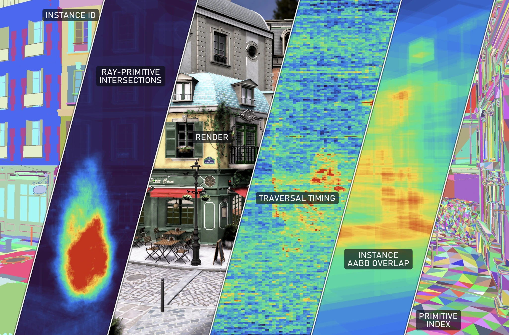

# GPU Raytracing Acceleration Viewer

A visual overview of GPU ray tracing diagnostics, including instance IDs, ray–primitive intersections, traversal timing, instance AABB overlap, and primitive indices.
